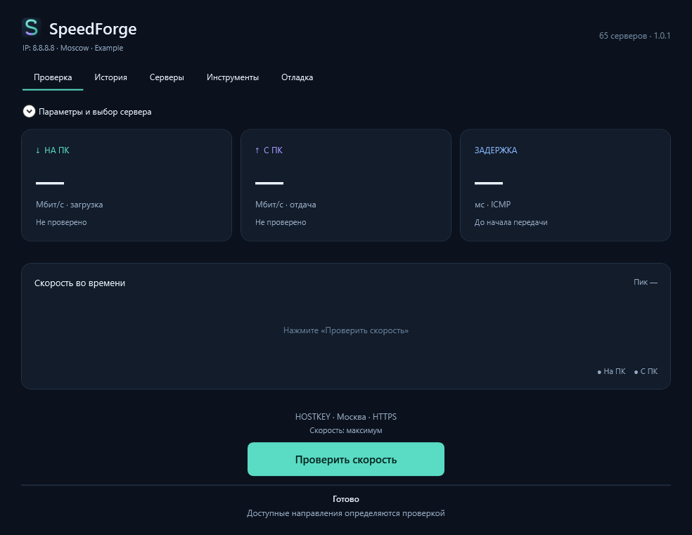

# SpeedForge

Тестер скорости для Windows: загрузка, отдача и задержка до сервера. Работает из одного exe, без установки.

[Скачать 1.0.1](https://github.com/BodySan/SpeedForge/releases/latest) · [Что изменилось](docs/RELEASE_1.0.1.md) · [Профили Билайна](docs/BEELINE_PROFILES.md)



На снимке — демонстрационный IP, личные данные не показаны.

## Как пользоваться

Запустите `SpeedForge.exe` и нажмите **«Проверить скорость»**. Во время теста этой же кнопкой можно остановить передачу.

Если геолокация включена, программа предложит сервер в ближайшем городе. Сервер, способ проверки и длительность можно изменить в раскрывающихся параметрах. Там же можно указать свой сервер. Внешний IP показан сверху — его можно выделить и скопировать.

**Загрузка** — скорость приёма на ваш компьютер. **Отдача** — скорость, которую подтвердил принимающий сервер. Программа проверяет направления по очереди. У некоторых HTTP-серверов есть только файл для загрузки, поэтому отдача на них недоступна.

Встроены iPerf2, iPerf3 и проверка через HTTP/HTTPS. В каталоге 65 серверных записей. Доступность зависит от сервера и вашего подключения: сервер может быть занят, не отвечать или поддерживать только один из выбранных режимов.

## Билайн

Для `speedcheck.gldn.net` программа проходит восемь профилей из исходного архива:

`1(100)` · `5(100)` · `10(100)` · `20(100)` · `1(1000)` · `5(1000)` · `10(1000)` · `20(1000)`

Совместимый iPerf2 из исходного архива уже встроен. Если сервер требует новую версию, программа подбирает её по корректному ответу.

По умолчанию каждый профиль проверяется 3 секунды. Для прогона с исходной длительностью установите 10 секунд в параметрах. В истории видно, какой профиль проверялся и что ответил сервер.

Числа в названии задают нагрузку теста, а не скорость вашего тарифа. Программа не привязана к 100 Мбит/с или другой фиксированной скорости. Если сервер не вернул отчёт о приёме, вместо скорости будет прочерк и пояснение **«Нет отчёта сервера»**. Когда подтверждена только часть потоков, результат отмечается как неполный.

## История и отладка

История сохраняется на компьютере. В каждой записи есть направление, профиль и результат. Через «Открыть debug» можно посмотреть команды и исходный ответ измерителя; во вкладке «Отладка» — сохранить журнал в ZIP.

Данные находятся в `%LOCALAPPDATA%\SpeedForge`. Журналы могут содержать сетевые адреса, поэтому перед отправкой проверьте их содержимое.

Геолокация определяется приблизительно по внешнему IP. Настройка сохраняется между запусками; ручной выбор сервера имеет приоритет. [Какие службы используются](docs/GEOIP.md).

## Сборка из исходников

Нужны Windows x64 и .NET SDK 10:

```powershell
./build-windows.ps1
./tests/run-sandbox.ps1 -NoBuild
```

Готовый файл появится в `publish/win-x64/SpeedForge.exe`. Проверки запускают настоящие iPerf- и HTTP-серверы на этом компьютере и сохраняют результаты в `sandbox-output`. [Подробности для разработчиков](CONTRIBUTING.md).

Код и оформление SpeedForge доступны по лицензии MIT. Для встроенных компонентов действуют [их собственные лицензии](third-party/NOTICE.md). [Источники каталога](docs/SOURCES.md).
