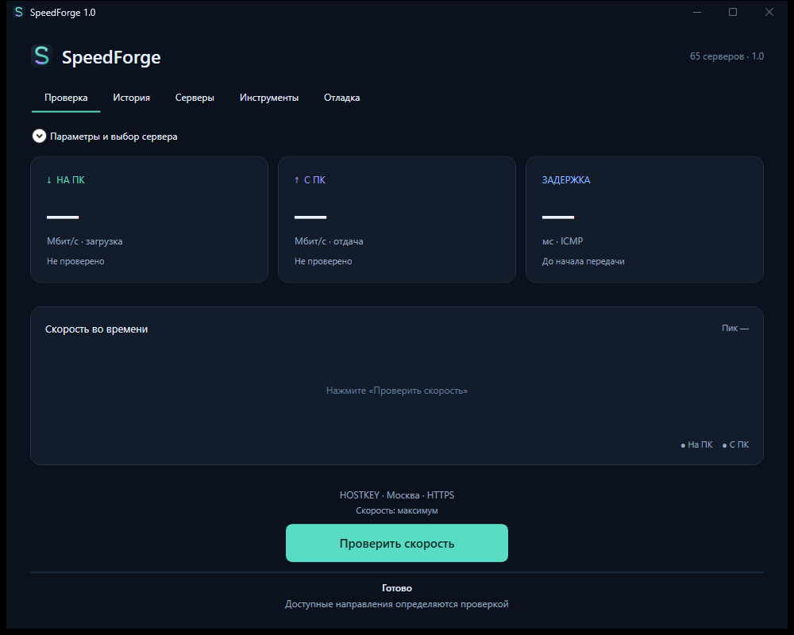

# SpeedForge 1.0

[Скачать portable exe](https://github.com/BodySan/SpeedForge/releases/latest) · [Исходники](https://github.com/BodySan/SpeedForge) · [Профили Билайн](docs/BEELINE_PROFILES.md)

Переносимый тест скорости для Windows x64. Запустите `SpeedForge.exe` и нажмите «Проверить скорость». Во время измерения эта же кнопка останавливает тест. На основном экране одна кнопка действия, две отдельные скорости и график.

Параметры и выбор сервера раскрываются сверху. По умолчанию выбран HOSTKEY HTTPS, максимальная скорость, 4 потока, 8 секунд. Программа проверяет доступные направления по очереди. Для iPerf2 сначала выполняется отдача с ПК; для iPerf3 и HTTP с приёмной точкой — загрузка, затем отдача. Для HTTP-файла без upload endpoint выполняется только загрузка. Ручное направление, TCP/UDP, длительность, лимит, IPv4/IPv6, ICMP и собственный сервер остаются в параметрах.

Ошибка одного направления не мешает проверить второе. TX без ACK сохраняется только в отладке; карточка скорости показывает «—», пока принимающая сторона не вернула отчёт. При смене сервера старые скорости и график очищаются. История и отладка находятся в отдельных вкладках. Иконка встроена в exe; системная рамка и заголовок поддерживают тёмную тему Windows.

Для Билайн `speedcheck.gldn.net` одна кнопка автоматически проходит все восемь профилей из предоставленного архива: 1, 5, 10 и 20 потоков с нагрузкой 100/1000 Мбит/с **на поток**. По умолчанию профиль длится 10 секунд. Затем отдельно проверяется загрузка на ПК с одним потоком. Итог отдачи — лучший полный отчёт приёмника. Заданная нагрузка 1 Гбит/с не означает, что сервер принял 1 Гбит/с. На канале 100 Мбит/с результат определяется реально полученными данными, без подмены тарифным лимитом. Общий ручной лимит ограничивает суммарную нагрузку всех потоков; профили можно отключить в дополнительных параметрах. [Параметры и методика](docs/BEELINE_PROFILES.md).

Лимит 0 = максимум. При переключении метода программа не подставляет 100 Мбит/с. Для iPerf3 UDP и собственного iPerf2 upload нулевой лимит передаётся явно; Билайн использует нагрузки из архива. iPerf2 reverse с нулевым запросом возвращался к стандартным 1 Мбит/с, поэтому ему запрашиваются 100 Гбит/с на поток; это указано в интерфейсе и debug. Длительность 3–30 секунд, ручные потоки 1–8 (автоматические профили Билайн — до 20), ручной общий лимит 1–2000 Мбит/с. HTTP ограничивает полезный трафик 512 МиБ на направление и вычисляет скорость по фактическому времени передачи.

## Песочница и проверка

Локальная песочница запускает настоящие HTTP, iPerf3 и iPerf2 только на `127.0.0.1`. Сценарии: оба направления, только с ПК, только на ПК, отказ обоих направлений, резервный порт, HTTP-файл, HTML/JSON вместо данных, сжатие, редирект, пустой ответ, занятость, обрыв, зависание, отмена, недоверенный TLS-сертификат, iPerf2 без ACK и ошибка сохранения debug.

Требуется .NET SDK 10. Сначала соберите приложение:

~~~powershell
./build-windows.ps1
~~~

Затем весь набор, включая проверки опубликованного exe:

~~~powershell
./tests/run-sandbox.ps1
~~~

Результаты сохраняются в `sandbox-output`; каталоги и журналы тестов изолированы от пользовательской истории. Все созданные процессы останавливаются в `finally`. Параметры `-OutputDirectory`, `-DesktopExe`, `-NoBuild`, `-NoUi` и `-UiOnly` позволяют повторять нужную часть проверки. Проект не запускает публичный сервер.

Набор проверяет настоящие измерители, восемь профилей Билайн и ситуацию «TX 1 Гбит/с через канал 100 Мбит/с». Автоматическая сборка и проверка настроены в GitHub Actions. Все 65 серверных записей проверены в основных протоколах; все 60 iPerf3 — также в UDP. Наблюдения по 125 сочетаниям сервера/протокола встроены в exe. Старый результат, ошибка либо занятость не запрещают следующий тест и не доказывают постоянной односторонности сервера.

Для повторения сетевой проверки:

~~~powershell
dotnet run --project tests/SpeedForge.SelfTests -c Release -- --audit-catalog ./catalog-results
dotnet run --project tests/SpeedForge.SelfTests -c Release -- --audit-catalog ./catalog-udp-results --udp
~~~

Эта проверка использует 3 секунды, 1 поток и лимит 10 Мбит/с на сервер; она проверяет передачу данных, а не максимальную скорость. Подробности, фактические итоги и гипотеза односторонней загрузки: `docs/RELEASE_0.4.md`.

## Переносимость и отладка

Для переноса достаточно одного `SpeedForge.exe`: .NET, iPerf3 3.22, iPerf2 2.2.2, DLL, лицензии и архивы исходников компонентов находятся внутри. Лицензии и исходники экспортируются во вкладке «Инструменты». Собственные измерители выбираются там же и проверяются по SHA-256.

История: `%LOCALAPPDATA%/SpeedForge/runs.jsonl`. Debug: `%LOCALAPPDATA%/SpeedForge/debug/<runId>`. Сохраняются DNS, выбранный IP, версии/хэши, точные аргументы, stdout/stderr, HTTP-ответы, ошибки, таймауты и отдельные итоги направлений. Debug ZIP экспортируется из вкладки «Отладка». Отчёт для поддержки отсутствует.

Собственный код и оформление SpeedForge распространяются под MIT. Сторонние компоненты имеют свои лицензии; сведения об источниках — [third-party/NOTICE.md](third-party/NOTICE.md). Изменения 1.0 описаны в [docs/RELEASE_1.0.md](docs/RELEASE_1.0.md).
