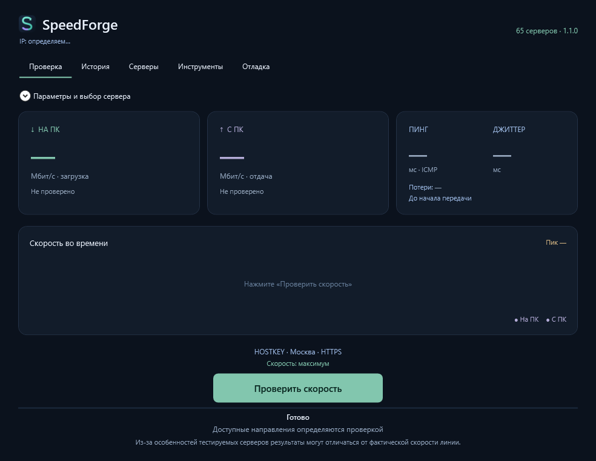
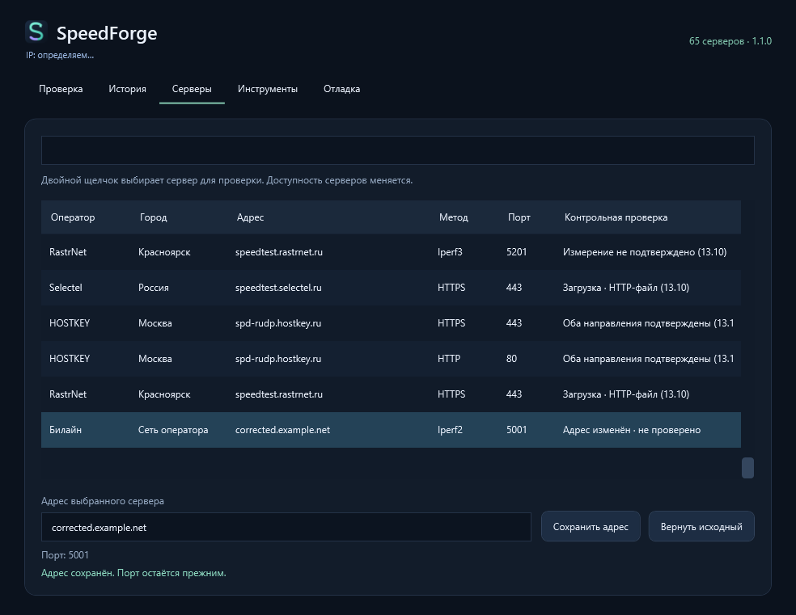

# SpeedForge

Тестер скорости для Windows: загрузка, отдача, пинг и джиттер до сервера. Работает из одного exe, без установки.

[Скачать 1.1.0](https://github.com/BodySan/SpeedForge/releases/tag/v1.1.0) · [Что изменилось](docs/RELEASE_1.1.0.md) · [Профили Билайна](docs/BEELINE_PROFILES.md)



На снимках показан интерфейс приложения; личные данные не показаны.

## Как пользоваться

Запустите `SpeedForge.exe` и нажмите **«Проверить скорость»**. Во время теста этой же кнопкой можно остановить передачу.

Если геолокация включена, программа предложит сервер в ближайшем городе. Сервер, способ проверки и длительность можно изменить в раскрывающихся параметрах. Там же можно указать свой сервер. Внешний IP показан сверху — его можно выделить и скопировать.

**Загрузка** — скорость приёма на ваш компьютер. **Отдача** — скорость, которую подтвердил принимающий сервер. Программа проверяет направления по очереди. У некоторых HTTP-серверов есть только файл для загрузки, поэтому отдача на них недоступна.

Встроены iPerf2, iPerf3 и проверка через HTTP/HTTPS. В каталоге 65 серверных записей. Доступность зависит от сервера и вашего подключения: сервер может быть занят, не отвечать или поддерживать только один из выбранных режимов.

Из-за особенностей тестируемых серверов результаты могут отличаться от фактической скорости линии. Это пояснение также показано внизу главного экрана.

## Если адрес сервера изменился

Откройте вкладку **«Серверы»**, выберите строку и измените адрес в поле под списком. Нажмите **«Сохранить адрес»** — следующая проверка будет использовать его, в том числе после перезапуска программы. Порты и пути HTTP-файлов сохраняются.

**«Вернуть исходный»** отменяет правку. Исправления записаны в `%LOCALAPPDATA%\SpeedForge\server-overrides.json`; этот файл можно скопировать на другой компьютер. Для изменённого адреса прежняя контрольная проверка больше не считается актуальной.



## Билайн

Режим iPerf2 проверяет исходящую UDP-отправку на `speedcheck.gldn.net` внутри сети оператора. Выберите скорость тарифа из списка **100, 200…1000 Мбит/с** и нажмите «Проверить скорость». Выбор запоминается. Программа выполняет один тест; потоки подбираются автоматически и записываются в debug.

Тариф задаёт общую нагрузку, а не готовый результат. По умолчанию отправка длится 10 секунд. Автоматической проверки загрузки с этого сервера нет.

Если пришёл полный отчёт сервера, показана подтверждённая скорость приёма. Без него показана **UDP-отправка с ПК** с пояснением: она не доказывает скорость доставки и потери в сети. Локальный результат не подменяется внешним HTTP-тестом.

Исходные 12 BAT/Python-профилей сохранены для консольной отладки. [Подробности](docs/BEELINE_PROFILES.md).

## История и отладка

История сохраняется на компьютере. В каждой записи есть направление, профиль и результат. Через «Открыть debug» можно посмотреть команды и исходный ответ измерителя; во вкладке «Отладка» — сохранить журнал в ZIP.

Пинг и джиттер показаны рядом; источник джиттера подписан как UDP или ICMP. Цвета помогают читать качество, а прочерк означает отсутствие данных. Время подготовки, передачи и ожидания отчёта показано отдельно — [как устроены тайминги](docs/TIMINGS.md).

Данные находятся в `%LOCALAPPDATA%\SpeedForge`. Журналы могут содержать сетевые адреса, поэтому перед отправкой проверьте их содержимое.

Геолокация определяется приблизительно по внешнему IP. Настройка сохраняется между запусками; ручной выбор сервера имеет приоритет. [Какие службы используются](docs/GEOIP.md).

## Сборка из исходников

Нужны Windows x64 и .NET SDK 10:

```powershell
./build-windows.ps1
./tests/run-sandbox.ps1 -NoBuild
```

Готовый файл появится в `publish/win-x64/SpeedForge.exe`. Проверки запускают настоящие iPerf- и HTTP-серверы на этом компьютере и сохраняют результаты в `sandbox-output`. [Подробности для разработчиков](CONTRIBUTING.md).

Код и оформление SpeedForge доступны по лицензии MIT. Для встроенных компонентов действуют [их собственные лицензии](third-party/NOTICE.md). [Источники каталога](docs/SOURCES.md).
